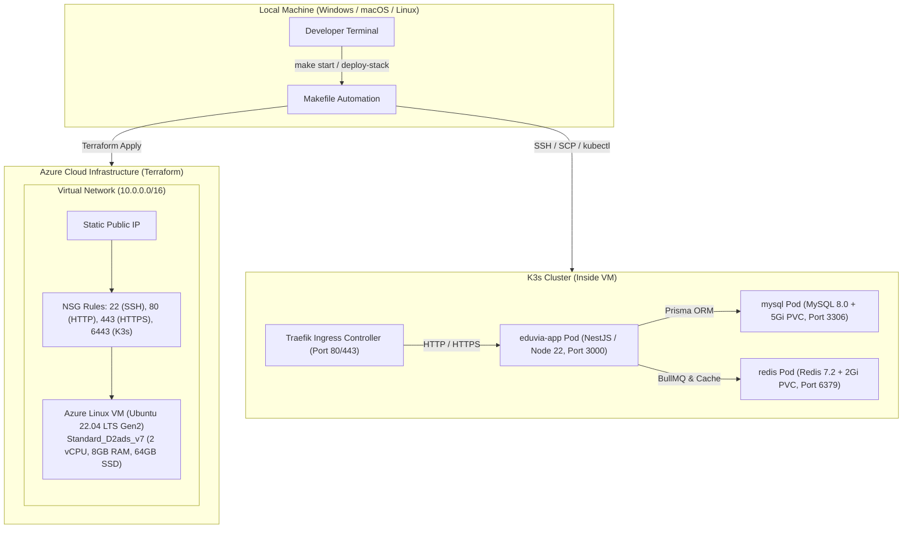

# Eduvia Infrastructure & Deployment Guide

This directory contains the Infrastructure as Code (IaC), containerization, and orchestration manifests for the **Eduvia Backend** on **Microsoft Azure** using a lightweight **K3s (Kubernetes)** architecture.

---

## 1. Architecture Overview



### Key Highlights
- **Zero Idle Cost**: Running `make stop` dumps the MySQL database to `eduvia_backup.sql` locally and executes `terraform destroy -auto-approve` so Azure billing drops to **\$0**.
- **One-Command Bootstrap**: Running `make start` brings up the Azure VM, installs Docker & K3s via cloud-init, provisions secrets, builds the Docker image, applies Kubernetes manifests, and restores database state.
- **Resource Optimization**: BullMQ on Redis handles asynchronous job queues and domain event outbox delivery natively, avoiding heavy messaging clusters and saving ~1.5 GB RAM.

---

## 2. Directory Layout

```
infrastructure/
├── README.md                  # This operations guide
├── docker/
│   └── docker-compose.yml     # Local developer stack (MySQL 8.0 + Redis 7)
├── Firebase/
│   └── .gitkeep               # Place Firebase Admin SDK credentials here
├── k8s/
│   └── base/
│       ├── eduvia-app-deployment.yaml # NestJS app Deployment & Service (port 3000)
│       ├── mysql-deployment.yaml      # MySQL 8.0 Deployment, PVC (5Gi), Service
│       ├── redis-deployment.yaml      # Redis 7 Deployment, PVC (2Gi), Service
│       ├── ingress.yaml               # Traefik Ingress routing for api.eduvia.name.ng
│       └── kustomization.yaml         # Kustomize root bundle
└── terraform/
    ├── main.tf                # Resource group, VNet, Subnet, NSG, VM, Public IP
    ├── variables.tf           # Configuration inputs (subscription_id, ssh_public_key, etc.)
    ├── outputs.tf             # Public and Private IP outputs
    ├── install_k3s.sh         # Cloud-init script to install Docker CE & K3s
    └── terraform.tfvars.example # Template for credentials
```

---

## 3. Prerequisites

1. **Azure CLI**: Logged in via `az login` with an active subscription.
2. **Terraform**: Version `>= 1.5.0` installed locally.
3. **OpenSSH**: Configured with an SSH key pair (default `~/.ssh/id_rsa_azure` or `%USERPROFILE%\.ssh\id_rsa_azure`).
4. **Make**: GNU Make or Windows `make.exe`.
5. **Configuration**:
   Copy `infrastructure/terraform/terraform.tfvars.example` to `infrastructure/terraform/terraform.tfvars` and provide your Azure subscription ID and SSH public key:
   ```hcl
   subscription_id     = "YOUR_AZURE_SUBSCRIPTION_ID"
   resource_group_name = "eduvia-k3s-rg"
   location            = "eastus"
   vm_size             = "Standard_D2ads_v7"
   ssh_public_key      = "ssh-rsa AAAA... YOUR_PUBLIC_KEY"
   ```

---

## 4. Operation Commands

### Full Deployment Workflow

Before the first deployment, create a Cloudflare Origin Certificate for
`api.eduvia.name.ng` and save it to the ignored paths
`infrastructure/tls/api.eduvia.name.ng.pem` and
`infrastructure/tls/api.eduvia.name.ng.key`. After the VM exists, create or
update the Kubernetes TLS secret:

```bash
make configure-tls
```

Keep Cloudflare SSL/TLS mode set to **Full (strict)**. The ingress accepts HTTPS
only and the application allows browser credentials only from
`https://app.eduvia.name.ng`.

```bash
# 1. Provision Azure infrastructure and boot the cluster
make start

# 2. Re-deploy manifests, sync secrets, or update app rollout
make deploy-stack

# 3. Build Docker image remotely and load into K3s containerd
make build-image

# 4. SSH into the Azure VM
make ssh

# 5. Open a local port forward to MySQL (localhost:3307 -> mysql:3306)
make mysql-tunnel

# 6. Backup the remote database to local eduvia_backup.sql
make backup-db

# 7. Restore local eduvia_backup.sql to remote MySQL
make restore-db

# 8. Follow live application logs (Ctrl+C to stop)
make logs

# 9. Destroy infrastructure ($0 billing) after backing up MySQL
make stop
```

---

## 5. Local Development Stack

To run MySQL and Redis locally without starting Kubernetes:

```bash
# Start MySQL and Redis in background
docker compose -f infrastructure/docker/docker-compose.yml up -d

# Stop and wipe local volumes
docker compose -f infrastructure/docker/docker-compose.yml down -v
```
